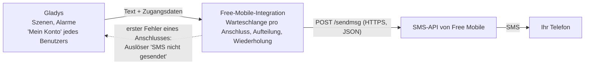
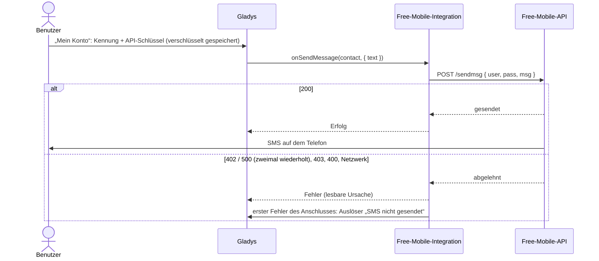
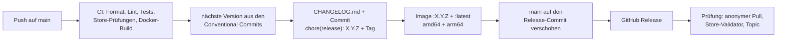

[English](README.md) · [Français](README.fr.md) · **Deutsch** · [Español](README.es.md)

# gladys-free-mobile

[](LICENSE)
[](https://github.com/William-De71/gladys-free-mobile/releases)
[](https://github.com/William-De71/gladys-free-mobile/actions/workflows/release.yml)
[](https://gladysassistant.com)


Externe Integration für [Gladys Assistant](https://gladysassistant.com), die Ihre Gladys-Benachrichtigungen **per SMS an Ihr eigenes Telefon** sendet, über die kostenlose **SMS-API von Free Mobile**. Sie ist die Portierung des historischen `free-mobile`-Dienstes aus dem Gladys-Kern in eine externe Integration: mit einem Klick aus dem Store installiert, in einem eigenen Container ausgeführt und unabhängig von Gladys aktualisiert.

📖 Benutzerdokumentation: [English](docs/en.md) — [Français](docs/fr.md) — [Deutsch](docs/de.md) — [Español](docs/es.md)

## Funktionen

- **SMS-Benachrichtigungen**: Die Szenen-Aktion „Nachricht senden“, Alarme und Benachrichtigungen erreichen das Telefon jedes Benutzers über seinen eigenen Free-Mobile-Anschluss.
- **Zugangsdaten pro Benutzer**: Jeder trägt seine Kennung und seinen API-Schlüssel im Block „Mein Konto“ ein; die Integration speichert nichts auf der Festplatte.
- **Lange Nachrichten**: Mehr als 999 Zeichen werden als mehrere nummerierte SMS verschickt, getrennt an Leerzeichen und Zeilenumbrüchen.
- **Sendelimit berücksichtigt**: Eine Warteschlange pro Free-Mobile-Anschluss, und die Antworten „nicht gesendet“ (402, 500) werden zweimal wiederholt.
- **Szenen-Auslöser „SMS nicht gesendet“**: Eine Szene startet beim ersten Fehler eines Anschlusses (falscher API-Schlüssel, deaktivierte Option, Störung bei Free Mobile…), damit Sie über einen anderen Kanal gewarnt werden.
- **Vier Sprachen**: Englisch, Französisch, Deutsch und Spanisch, in Gladys und in der Dokumentation.

## Funktionsweise




Free Mobile bietet nur einen ausgehenden Webhook: Er sendet eine SMS **an die Rufnummer des Anschlusses, zu dem die Zugangsdaten gehören** — nie an eine beliebige Nummer, und es kommt nichts zurück. Die Integration ist daher eine **reine Sende-Kommunikationsintegration** (`type: "communication"`, `messaging: { receive: false }`):

| Seite von Gladys                                | Was die Integration tut                                                        |
| ----------------------------------------------- | ------------------------------------------------------------------------------ |
| Aktion „Nachricht senden“, Alarme, Hinweise     | Eine SMS an das Telefon des Benutzers (`onSendMessage`)                        |
| Nachricht mit mehr als 999 Zeichen              | Mehrere SMS, getrennt an Leerzeichen / Zeilenumbrüchen und nummeriert `(1/2)`… |
| Mehrere Nachrichten für denselben Benutzer      | Nacheinander gesendet, damit das Sendelimit nicht greift                       |
| Free Mobile antwortet 402 (zu schnell) oder 500 | Nach 2 s, dann 5 s wiederholt, danach als lesbarer Fehler gemeldet             |
| Erster Fehler eines Free-Mobile-Anschlusses     | Szenen-Auslöser „SMS nicht gesendet“ (`publishSceneEvent`)                     |
| Angehängtes Bild (`message.file`)               | Ignoriert: Eine Free-Mobile-SMS enthält nur Text                               |
| Antwort auf die SMS                             | Unmöglich: kein eingehender Weg, kein Verknüpfungscode, kein `publishMessage`  |

Die Zugangsdaten gelten **pro Benutzer**, nicht global: Jeder trägt seine Kennung und seinen API-Schlüssel ein, und Gladys übergibt sie der Integration mit jeder ausgehenden Nachricht.

### Von der Szene zur SMS



## Konfiguration

Alles wird pro Benutzer im Block **„Mein Konto“** der Konfigurationsseite eingestellt (`contact_schema` des Manifests):

| Feld                      | Schlüssel      | Typ      | Pflicht | Inhalt                                                                      |
| ------------------------- | -------------- | -------- | ------- | --------------------------------------------------------------------------- |
| Free-Mobile-Kennung       | `username`     | `string` | ja      | der 8-stellige Login der Seite „Notifications par SMS“                      |
| Free-Mobile-API-Schlüssel | `access_token` | `secret` | ja      | der Schlüssel dieser Seite, verschlüsselt gespeichert, nie wieder angezeigt |


1. Ein **Free-Mobile**-Anschluss mit aktivierter Option **„Notifications par SMS“** (`mobile.free.fr` → „Mes options“).
2. In Gladys trägt jeder Benutzer **seine eigene** Kennung und seinen API-Schlüssel im Block **„Mein Konto“** der Konfigurationsseite der Integration ein.
3. Speichern. Es ist kein Verknüpfungscode zu erzeugen: Free Mobile hat keinen Kanal, um ihn zu übermitteln, und ein reiner Sendekanal trägt keine Benutzerberechtigung, die zu schützen wäre. Benutzer ohne Zugangsdaten überspringt Gladys einfach.

Um eine Szenen-Nachricht **nur per SMS** zu senden, wählen Sie **Free Mobile SMS** in der Liste **„Senden über“** der Aktion „Nachricht senden“ (Gladys 4.86 oder neuer); standardmäßig geht eine Nachricht an alle Nachrichtendienste des Benutzers.

## Transport

Das Manifest deklariert `transports: ["cloud"]`: Jede SMS läuft über die Server von Free Mobile im Internet. Es gibt kein Gerät und daher kein Transport-Badge zu veröffentlichen.

## Szenen

| Auslöser             | Schlüssel      | Wann                                                                                                                |
| -------------------- | -------------- | ------------------------------------------------------------------------------------------------------------------- |
| „SMS nicht gesendet“ | `sms_not_sent` | beim ersten Fehler eines Free-Mobile-Anschlusses, danach erst wieder, nachdem eine SMS dieses Anschlusses durchging |

- Filter **Ursachen** (optional, mehrere Werte): `access_denied`, `rate_limited`, `server_error`, `timeout`, `unreachable`, `invalid_message`, `unexpected`.
- Variablen: `{{triggerEvent.data.reason}}`, `{{triggerEvent.data.status}}` (HTTP-Status, leer ohne Antwort), `{{triggerEvent.data.error}}` (auf Englisch, wie in den Protokollen), `{{triggerEvent.data.account}}` (maskierte Kennung, `12****78`).
- Beispiel: Auslöser „SMS nicht gesendet“, Ursache „Zugriff verweigert“ → Aktion „Nachricht senden“ über **Telegram**: `Free Mobile hat eine SMS abgelehnt ({{triggerEvent.data.error}}): Prüfen Sie den API-Schlüssel.`

Ein Ereignis pro Übergang verhindert Schleifen: Eine Szene, die Sie über denselben Kanal warnt, scheitert erneut, und dieser zweite Fehler löst nichts aus.

## Senden einer Nachricht


## Designentscheidungen

**Der API-Schlüssel steht nie in einer URL.** Free Mobile akzeptiert die Parameter in der Query-String eines GET oder im Body eines POST. Die Integration sendet sie als JSON: Eine Query-String landet in Proxy- und Zugriffsprotokollen, ein Body nicht. Fehlermeldungen geben die Anfrage nie wieder, und die Kennung wird in den Protokollen maskiert (`12****78`).

**Nur Antworten „nicht gesendet“ werden wiederholt.** Ein 402 oder 500 bedeutet, dass Free Mobile die SMS nicht gesendet hat: Eine Wiederholung kann sie also nicht doppelt zustellen. Eine Zeitüberschreitung wird _nicht_ wiederholt: Die SMS kann verschickt worden sein, bevor die Antwort verloren ging, und ein doppelter Alarm ist schlimmer als ein gemeldeter Fehler.

**Eine Warteschlange pro Konto, keine globale.** Das Sendelimit gilt für einen Free-Mobile-Anschluss: Zwei Benutzer warten nie aufeinander, und eine fehlgeschlagene Nachricht blockiert die folgenden nicht.

**Jeder sichtbare Text existiert in den vier Sprachen von Gladys** (en, fr, de, es). `test/i18n.test.js` schlägt fehl, wenn einem Manifest-Text, einer Dokumentation oder einer README eine davon fehlt.

## Installation

In Gladys (5.3.0 oder neuer): **Integrationen → Store → Free Mobile SMS → Installieren**. Der Store listet die Integration im Laufe des Tages nach einem Release.

Um einen Build vor seinem Release zu testen: **Integrationen → Integration installieren → Entwicklermodus**, mit dem Manifest aus der Zusammenfassung des Workflows „Build and publish image“.

## Entwicklung

```
index.js              nur SDK-Verdrahtung: createApp(new GladysIntegration()) + connect
src/
  app.js              alle Handler: onSendMessage, Warteschlange pro Anschluss, Lebenszyklus
  free-mobile.js      der HTTP-Aufruf an Free Mobile: POST, Aufteilung, Wiederholung, Fehlerursachen
  events.js           Auslöser „SMS nicht gesendet“, einmal pro fehlerhaftem Anschluss
  config.js           Zugangsdaten pro Benutzer: Normalisierung, Prüfung, Maskierung
test/                 node:test, ohne Netzwerk (Fake-Gladys des SDK, Fake-fetch)
docs/                 Benutzerdokumentation (en / fr / de / es) und Diagramme
.github/scripts/      release.mjs: Version, Changelog, Versionsdateien, PR-Titel
```

```bash
npm install
npm test              # node:test, greift nie auf das Netzwerk zu
npm run lint          # ESLint 10, Flat-Config
npm run format:check  # Prettier
npx github:GladysAssistant/integration-store . --skip-image-check
```

## Tests

- `test/app.test.js`: die Handler über das Fake-Gladys des SDK (`@gladysassistant/integration-sdk/testing`): Nachricht gesendet, fehlende Zugangsdaten, Szenen-Ereignis einmal pro fehlerhaftem Anschluss, Daten innerhalb der Grenzen des Kerns, API-Schlüssel nie in einem Ereignis.
- `test/free-mobile.test.js`: der HTTP-Aufruf, die Aufteilung, die Wiederholungen, die Warteschlange.
- `test/structure.test.js`: Die von Benutzern der 1.2.0 gespeicherten Schlüssel (`test/fixtures/manifest.baseline.json`) bleiben unverändert.
- `test/i18n.test.js`, `test/manifest.test.js`: vier Sprachen, Store-Grenzen, Dokumentation und READMEs.
- `test/release.test.js`: Versionen, Changelog, Versionsdateien und PR-Titel.

## Release

Releases erfolgen **automatisch**: Jeder Push auf `main` veröffentlicht eine Version, wenn seine Commits es rechtfertigen.



- **Commit-Konvention** ([Conventional Commits](https://www.conventionalcommits.org/de/)): `feat` → Minor, `fix` und `perf` → Patch, `!` oder `BREAKING CHANGE:` → Major; `docs`, `chore`, `ci`, `test`, `style`, `refactor` und `build` allein veröffentlichen nichts. Der PR-Titel wird zum Squash-Commit und zur Changelog-Zeile: Schreiben Sie ihn auf Englisch, für den Benutzer.
- `main` erhält das Manifest mit der neuen Version erst, wenn das Image existiert: Der Store kündigt nie eine Version an, die Gladys nicht laden kann.
- Manueller Start (**Actions → Release → Run workflow**): `release-as` erzwingt eine Version, `dry-run` zeigt Version und Changelog, ohne etwas zu veröffentlichen.
- `CHANGELOG.md` wird erzeugt: Bearbeiten Sie die Datei nie von Hand.
- Ist `main` geschützt, erlauben Sie GitHub Actions, die Regel zu umgehen (der Release-Commit wird vom Workflow gepusht), oder verwenden Sie das Token einer GitHub App.

## Fehlerbehebung

- **Keine SMS erhalten**: Prüfen Sie, ob die Option „Notifications par SMS“ aktiviert ist und Kennung und API-Schlüssel stimmen; die Registerkarte „Überwachung“ der Integration zeigt ihre Protokolle mit der Ursache.
- **„access denied“**: falsche Kennung oder falscher Schlüssel, oder die Option ist deaktiviert. Deaktivieren und erneutes Aktivieren der Option erzeugt einen neuen Schlüssel.
- **„too many SMS sent“**: mehrere Nachrichten innerhalb weniger Sekunden; verteilen Sie die Aktionen „Nachricht senden“ Ihrer Szenen zeitlich.
- **„timed out“**: Free Mobile hat nicht rechtzeitig geantwortet; die SMS kann trotzdem ankommen und wird daher nicht erneut gesendet.
- **Update wird nicht angeboten**: Die Integration erfordert Gladys 5.3.0 (Katalog-Schlagwörter und -Länder von Gladys 5.3); aktualisieren Sie zuerst Gladys.

## Mitwirken

Issues und Pull Requests sind willkommen: [Fehler melden](https://github.com/William-De71/gladys-free-mobile/issues/new/choose) (mit den Versionen von Gladys und der Integration und den Protokollen, idealerweise mit `DEBUG=gladys-integration-sdk`), oder der [Forenthread](https://community.gladysassistant.com/t/10366). Sicherheitsprobleme: siehe [SECURITY.md](SECURITY.md).

## Lizenz

[Apache-2.0](LICENSE) — siehe auch [NOTICE](NOTICE). Free Mobile ist eine Marke der Free Mobile SAS; dieses Projekt steht in keiner Verbindung zu Free Mobile.
