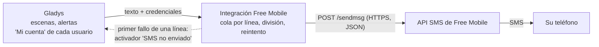
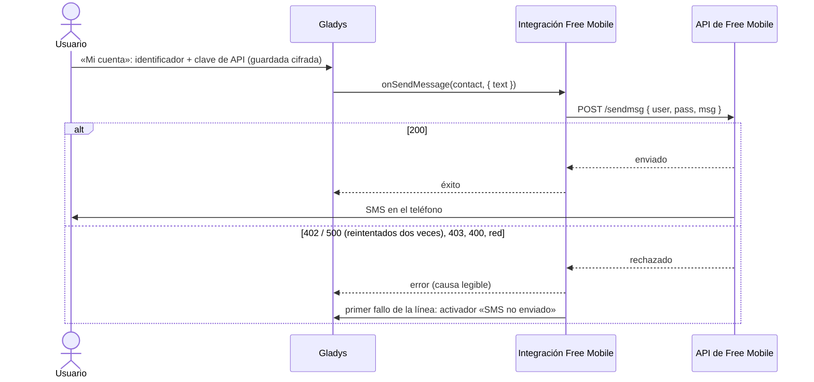
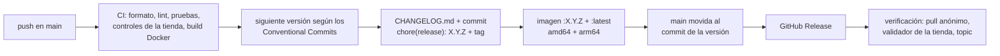

[English](README.md) · [Français](README.fr.md) · [Deutsch](README.de.md) · **Español**

# gladys-free-mobile

[](LICENSE)
[](https://github.com/William-De71/gladys-free-mobile/releases)
[](https://github.com/William-De71/gladys-free-mobile/actions/workflows/release.yml)
[](https://gladysassistant.com)


Integración externa de [Gladys Assistant](https://gladysassistant.com) que envía sus notificaciones de Gladys **por SMS a su propio teléfono**, a través de la **API SMS gratuita de Free Mobile**. Es la adaptación como integración externa del servicio histórico `free-mobile` del núcleo: se instala desde la tienda con un clic, se ejecuta en su propio contenedor y se actualiza independientemente de Gladys.

📖 Documentación de usuario: [English](docs/en.md) — [Français](docs/fr.md) — [Deutsch](docs/de.md) — [Español](docs/es.md)

## Funcionalidades

- **Notificaciones por SMS**: la acción de escena «Enviar mensaje», las alertas y las notificaciones llegan al teléfono de cada usuario, a través de su propia línea de Free Mobile.
- **Credenciales por usuario**: cada uno introduce su identificador y su clave de API en el bloque «Mi cuenta»; la integración no guarda nada en disco.
- **Mensajes largos**: más de 999 caracteres se envían en varios SMS numerados, cortados en los espacios y saltos de línea.
- **Límite de envío gestionado**: una cola por línea de Free Mobile, y las respuestas «no enviado» (402, 500) se reintentan dos veces.
- **Activador de escena «SMS no enviado»**: una escena se inicia con el primer fallo de una línea (clave de API errónea, opción desactivada, avería de Free Mobile…), para recibir un aviso por otro canal.
- **Cuatro idiomas**: inglés, francés, alemán y español, en Gladys y en la documentación.

## Funcionamiento




Free Mobile ofrece solo un webhook saliente: envía un SMS **al número de la línea a la que pertenecen las credenciales** — nunca a un número cualquiera, y no vuelve nada. Por eso la integración es una **integración de comunicación de solo envío** (`type: "communication"`, `messaging: { receive: false }`):

| Lado de Gladys                                    | Lo que hace la integración                                                      |
| ------------------------------------------------- | ------------------------------------------------------------------------------- |
| Acción «Enviar mensaje», alertas, avisos          | Un SMS al teléfono del usuario (`onSendMessage`)                                |
| Mensaje de más de 999 caracteres                  | Varios SMS, cortados en espacios / saltos de línea y numerados `(1/2)`…         |
| Varios mensajes para el mismo usuario a la vez    | Enviados uno tras otro, para no alcanzar el límite de envío                     |
| Free Mobile responde 402 (demasiado rápido) o 500 | Reintentado tras 2 s y luego 5 s, después se informa con un error legible       |
| Primer fallo de una línea de Free Mobile          | Activador de escena «SMS no enviado» (`publishSceneEvent`)                      |
| Imagen adjunta (`message.file`)                   | Ignorada: un SMS de Free Mobile solo lleva texto                                |
| Respuesta al SMS                                  | Imposible: sin camino entrante, sin código de vinculación, sin `publishMessage` |

Las credenciales son **por usuario**, no globales: cada uno introduce su identificador y su clave de API, y Gladys las entrega a la integración con cada mensaje saliente.

### De la escena al SMS



## Configuración

Todo se ajusta por usuario, en el bloque **«Mi cuenta»** de la página de configuración (`contact_schema` del manifiesto):

| Campo                        | Clave          | Tipo     | Obligatorio | Contenido                                                        |
| ---------------------------- | -------------- | -------- | ----------- | ---------------------------------------------------------------- |
| Identificador de Free Mobile | `username`     | `string` | sí          | el login de 8 cifras de la página «Notifications par SMS»        |
| Clave de API de Free Mobile  | `access_token` | `secret` | sí          | la clave de esa página, guardada cifrada, no se vuelve a mostrar |


1. Una línea **Free Mobile** con la opción **«Notifications par SMS»** activada (`mobile.free.fr` → «Mes options»).
2. En Gladys, cada usuario introduce **su propio** identificador y su clave de API en el bloque **«Mi cuenta»** de la página de configuración de la integración.
3. Guarde. No hay código de vinculación que generar: Free Mobile no tiene ningún canal para enviarlo, y un canal de solo envío no lleva ninguna autoridad de usuario que proteger. Gladys simplemente omite a los usuarios sin credenciales.

Para enviar un mensaje de escena **solo por SMS**, elija **Free Mobile SMS** en la lista **«Enviar mediante»** de la acción «Enviar mensaje» (Gladys 4.86 o posterior); de forma predeterminada, un mensaje se envía a todos los servicios de mensajería del usuario.

## Transporte

El manifiesto declara `transports: ["cloud"]`: cada SMS pasa por los servidores de Free Mobile en Internet. No hay ningún dispositivo, así que no hay insignia de transporte que publicar.

## Escenas

| Activador        | Clave          | Cuándo                                                                                                         |
| ---------------- | -------------- | -------------------------------------------------------------------------------------------------------------- |
| «SMS no enviado» | `sms_not_sent` | con el primer fallo de una línea de Free Mobile y solo de nuevo después de que un SMS de esa línea haya pasado |

- Filtro **Causas** (opcional, varios valores): `access_denied`, `rate_limited`, `server_error`, `timeout`, `unreachable`, `invalid_message`, `unexpected`.
- Variables: `{{triggerEvent.data.reason}}`, `{{triggerEvent.data.status}}` (código HTTP, vacío sin respuesta), `{{triggerEvent.data.error}}` (en inglés, como en los registros), `{{triggerEvent.data.account}}` (identificador enmascarado, `12****78`).
- Ejemplo: activador «SMS no enviado», causa «Acceso denegado» → acción «Enviar mensaje» mediante **Telegram**: `Free Mobile rechazó un SMS ({{triggerEvent.data.error}}): compruebe la clave de API.`

Un solo evento por transición impide que las escenas entren en bucle: una escena que le avisa por este mismo canal vuelve a fallar, y ese segundo fallo no activa nada.

## Envío de un mensaje


## Decisiones de diseño

**La clave de API nunca viaja en una URL.** Free Mobile acepta los parámetros en la query string de un GET o en el cuerpo de un POST. La integración los envía en JSON: una query string acaba en los registros de proxys y servidores, un cuerpo no. Los errores nunca repiten la petición, y el identificador se enmascara en los registros (`12****78`).

**Solo se reintentan las respuestas «no enviado».** Un 402 o un 500 significa que Free Mobile no envió el SMS: un reintento no puede entregarlo dos veces. Un tiempo de espera agotado _no_ se reintenta: el SMS puede haber salido antes de que se perdiera la respuesta, y una alerta duplicada es peor que un fallo comunicado.

**Una cola por cuenta, no una cola global.** El límite de envío se aplica a una línea de Free Mobile: dos usuarios nunca se esperan, y un mensaje fallido no bloquea los siguientes.

**Cada texto visible existe en los cuatro idiomas de Gladys** (en, fr, de, es). `test/i18n.test.js` falla si a un texto del manifiesto, una documentación o un README le falta alguno.

## Instalación

Desde Gladys (5.3.0 o posterior): **Integraciones → Tienda → Free Mobile SMS → Instalar**. La tienda incluye la integración en el día siguiente a una versión.

Para probar una compilación antes de su versión: **Integraciones → Instalar una integración → Modo desarrollador**, con el manifiesto que aparece en el resumen del workflow «Build and publish image».

## Desarrollo

```
index.js              solo el cableado del SDK: createApp(new GladysIntegration()) + connect
src/
  app.js              todos los handlers: onSendMessage, cola por línea, ciclo de vida
  free-mobile.js      la llamada HTTP a Free Mobile: POST, división, reintento, causas de fallo
  events.js           activador «SMS no enviado», una vez por línea con fallos
  config.js           credenciales por usuario: normalización, validación, enmascarado
test/                 node:test, sin red (Gladys falso del SDK, fetch falso)
docs/                 documentación de usuario (en / fr / de / es) y diagramas
.github/scripts/      release.mjs: versión, changelog, archivos de versión, títulos de PR
```

```bash
npm install
npm test              # node:test, nunca toca la red
npm run lint          # ESLint 10, configuración flat
npm run format:check  # Prettier
npx github:GladysAssistant/integration-store . --skip-image-check
```

## Pruebas

- `test/app.test.js`: los handlers a través del Gladys falso del SDK (`@gladysassistant/integration-sdk/testing`): mensaje enviado, credenciales ausentes, evento de escena una vez por línea con fallos, datos dentro de los límites del núcleo, clave de API nunca en un evento.
- `test/free-mobile.test.js`: la llamada HTTP, la división, los reintentos, la cola.
- `test/structure.test.js`: las claves guardadas por los usuarios de la 1.2.0 (`test/fixtures/manifest.baseline.json`) no cambian.
- `test/i18n.test.js`, `test/manifest.test.js`: cuatro idiomas, límites de la tienda, documentación y README.
- `test/release.test.js`: versiones, changelog, archivos de versión y títulos de PR.

## Publicación

Las versiones se publican **automáticamente**: cada push en `main` publica una versión cuando sus commits lo justifican.



- **Convención de commits** ([Conventional Commits](https://www.conventionalcommits.org/es/)): `feat` → menor, `fix` y `perf` → parche, `!` o `BREAKING CHANGE:` → mayor; `docs`, `chore`, `ci`, `test`, `style`, `refactor` y `build` solos no publican nada. El título de la PR se convierte en el commit squash y en la línea del changelog: escríbalo en inglés, para el usuario.
- `main` solo recibe el manifiesto con la nueva versión cuando la imagen existe: la tienda nunca anuncia una versión que Gladys no pueda descargar.
- Ejecución manual (**Actions → Release → Run workflow**): `release-as` fuerza una versión, `dry-run` muestra la versión y el changelog sin publicar nada.
- `CHANGELOG.md` se genera: no lo edite nunca a mano.
- Si `main` está protegida, permita que GitHub Actions omita la regla (el commit de la versión lo envía el workflow), o use el token de una GitHub App.

## Solución de problemas

- **No recibo ningún SMS**: compruebe que la opción «Notifications par SMS» está activada y que el identificador y la clave de API son correctos; la pestaña «Supervisión» de la integración muestra sus registros, con la causa.
- **«access denied»**: identificador o clave incorrectos, u opción desactivada. Desactivar y reactivar la opción genera una nueva clave.
- **«too many SMS sent»**: varios mensajes en pocos segundos; espacie las acciones «Enviar mensaje» de sus escenas.
- **«timed out»**: Free Mobile no respondió a tiempo; el SMS aún puede llegar, por eso no se reenvía.
- **No se ofrece la actualización**: la integración requiere Gladys 5.3.0 (palabras clave y países del catálogo de Gladys 5.3); actualice primero Gladys.

## Contribuir

Issues y pull requests son bienvenidos: [informar de un error](https://github.com/William-De71/gladys-free-mobile/issues/new/choose) (con las versiones de Gladys y de la integración y los registros, idealmente con `DEBUG=gladys-integration-sdk`), o el [hilo del foro](https://community.gladysassistant.com/t/10366). Problemas de seguridad: vea [SECURITY.md](SECURITY.md).

## Licencia

[Apache-2.0](LICENSE) — vea también [NOTICE](NOTICE). Free Mobile es una marca de Free Mobile SAS; este proyecto no está afiliado a Free Mobile.
