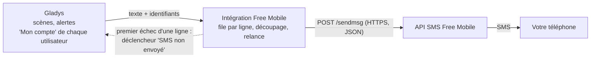
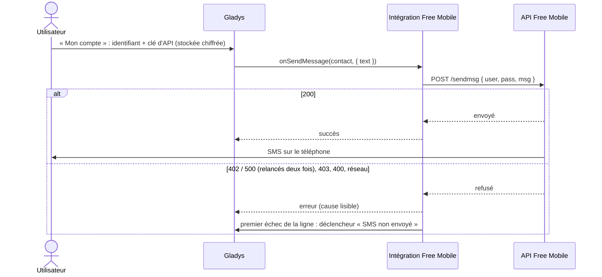
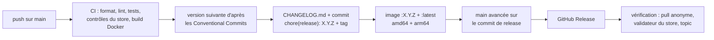

[English](README.md) · **Français** · [Deutsch](README.de.md) · [Español](README.es.md)

# gladys-free-mobile

[](LICENSE)
[](https://github.com/William-De71/gladys-free-mobile/releases)
[](https://github.com/William-De71/gladys-free-mobile/actions/workflows/release.yml)
[](https://gladysassistant.com)


Intégration externe de [Gladys Assistant](https://gladysassistant.com) qui envoie vos notifications Gladys **par SMS sur votre propre téléphone**, via l'**API SMS gratuite de Free Mobile**. C'est le portage en intégration externe du service historique `free-mobile` du cœur : installée depuis le store en un clic, exécutée dans son propre conteneur, mise à jour indépendamment de Gladys.

📖 Documentation utilisateur : [English](docs/en.md) — [Français](docs/fr.md) — [Deutsch](docs/de.md) — [Español](docs/es.md)

## Fonctionnalités

- **Notifications par SMS** : l'action de scène « Envoyer un message », les alertes et les notifications arrivent sur le téléphone de chaque utilisateur, via sa propre ligne Free Mobile.
- **Identifiants par utilisateur** : chacun saisit son identifiant et sa clé d'API dans le bloc « Mon compte » ; l'intégration n'enregistre rien sur disque.
- **Messages longs** : au-delà de 999 caractères, le message part en plusieurs SMS numérotés, coupés sur les espaces et les retours à la ligne.
- **Limite de débit gérée** : une file par ligne Free Mobile, et les réponses « non envoyé » (402, 500) sont retentées deux fois.
- **Déclencheur de scène « SMS non envoyé »** : une scène démarre au premier échec d'une ligne (clé d'API erronée, option désactivée, Free Mobile en panne…), pour être prévenu par un autre canal.
- **Quatre langues** : anglais, français, allemand et espagnol, dans Gladys et dans la documentation.

## Fonctionnement




Free Mobile propose un webhook sortant uniquement : il envoie un SMS **au numéro de la ligne à laquelle appartiennent les identifiants** — jamais à un numéro quelconque, et rien ne revient. L'intégration est donc une **intégration de communication en envoi seul** (`type: "communication"`, `messaging: { receive: false }`) :

| Côté Gladys                                  | Ce que fait l'intégration                                                           |
| -------------------------------------------- | ----------------------------------------------------------------------------------- |
| Action « Envoyer un message », alertes, avis | Un SMS sur le téléphone de l'utilisateur (`onSendMessage`)                          |
| Message de plus de 999 caractères            | Plusieurs SMS, coupés sur les espaces / retours à la ligne, numérotés `(1/2)`…      |
| Plusieurs messages pour le même utilisateur  | Envoyés l'un après l'autre, pour ne pas atteindre la limite de débit                |
| Free Mobile répond 402 (trop vite) ou 500    | Relancé après 2 s, puis 5 s, puis signalé par une erreur lisible                    |
| Premier échec d'une ligne Free Mobile        | Déclencheur de scène « SMS non envoyé » (`publishSceneEvent`)                       |
| Image jointe (`message.file`)                | Ignorée : un SMS Free Mobile ne transporte que du texte                             |
| Réponse au SMS                               | Impossible : pas de chemin entrant, pas de code de liaison, pas de `publishMessage` |

Les identifiants sont **par utilisateur**, pas globaux : chacun saisit son identifiant et sa clé d'API, et Gladys les transmet à l'intégration avec chaque message sortant.

### De la scène au SMS



## Configuration

Tout se règle par utilisateur, dans le bloc **« Mon compte »** de la page de configuration (`contact_schema` du manifeste) :

| Champ                   | Clé            | Type     | Obligatoire | Contenu                                                        |
| ----------------------- | -------------- | -------- | ----------- | -------------------------------------------------------------- |
| Identifiant Free Mobile | `username`     | `string` | oui         | le login à 8 chiffres de la page « Notifications par SMS »     |
| Clé d'API Free Mobile   | `access_token` | `secret` | oui         | la clé de cette page, stockée chiffrée, plus jamais réaffichée |


1. Une ligne **Free Mobile** avec l'option **« Notifications par SMS »** activée (`mobile.free.fr` → « Mes options »).
2. Dans Gladys, chaque utilisateur renseigne **son propre** identifiant et sa clé d'API dans le bloc **« Mon compte »** de la page de configuration de l'intégration.
3. Enregistrez. Aucun code de liaison à générer : Free Mobile n'a aucun canal pour le transmettre, et un canal en envoi seul ne porte aucune autorité d'utilisateur à protéger. Gladys ignore simplement les utilisateurs sans identifiants.

Pour envoyer un message de scène **uniquement par SMS**, choisissez **Free Mobile SMS** dans la liste **« Envoyer via »** de l'action « Envoyer un message » (Gladys 4.86 ou plus récent) ; par défaut, un message part sur tous les services de messagerie de l'utilisateur.

## Transport

Le manifeste déclare `transports: ["cloud"]` : chaque SMS passe par les serveurs de Free Mobile sur Internet. Il n'y a pas d'appareil, donc pas de badge de transport à publier.

## Scènes

| Déclencheur        | Clé            | Quand                                                                                             |
| ------------------ | -------------- | ------------------------------------------------------------------------------------------------- |
| « SMS non envoyé » | `sms_not_sent` | au premier échec d'une ligne Free Mobile, puis seulement après qu'un SMS de cette ligne est passé |

- Filtre **Causes** (facultatif, plusieurs valeurs) : `access_denied`, `rate_limited`, `server_error`, `timeout`, `unreachable`, `invalid_message`, `unexpected`.
- Variables : `{{triggerEvent.data.reason}}`, `{{triggerEvent.data.status}}` (code HTTP, vide sans réponse), `{{triggerEvent.data.error}}` (en anglais, comme dans les journaux), `{{triggerEvent.data.account}}` (identifiant masqué, `12****78`).
- Exemple : déclencheur « SMS non envoyé », cause « Accès refusé » → action « Envoyer un message » via **Telegram** : `Free Mobile a refusé un SMS ({{triggerEvent.data.error}}) : vérifiez la clé d'API.`

Un seul événement par transition empêche les scènes de boucler : une scène qui vous prévient par ce même canal échoue à nouveau, et ce second échec ne déclenche rien.

## Envoi d'un message


## Choix de conception

**La clé d'API ne passe jamais dans une URL.** Free Mobile accepte les paramètres dans la query string d'un GET ou dans le corps d'un POST. L'intégration les poste en JSON : une query string finit dans les journaux des proxys et des serveurs, un corps non. Les erreurs ne reprennent jamais la requête, et l'identifiant est masqué dans les journaux (`12****78`).

**Seules les réponses « non envoyé » sont relancées.** Un 402 ou un 500 signifie que Free Mobile n'a pas envoyé le SMS : une relance ne peut donc pas le délivrer deux fois. Un dépassement de délai n'est _pas_ relancé : le SMS a pu partir avant que la réponse se perde, et une alerte en double est pire qu'un échec signalé.

**Une file par compte, pas une file globale.** La limite de débit s'applique à une ligne Free Mobile : deux utilisateurs ne s'attendent jamais, et un message en échec ne bloque pas ceux qui le suivent.

**Chaque texte visible existe dans les quatre langues de Gladys** (en, fr, de, es). `test/i18n.test.js` échoue si un texte du manifeste, une doc ou un README en manque une.

## Installation

Depuis Gladys (5.1.0 ou plus récent) : **Intégrations → Store → Free Mobile SMS → Installer**. Le store référence l'intégration dans la journée qui suit une release.

Pour tester un build avant sa release : **Intégrations → Installer une intégration → Mode développeur**, avec le manifeste affiché dans le résumé du workflow « Build and publish image ».

## Développement

```
index.js              câblage du SDK seulement : createApp(new GladysIntegration()) + connect
src/
  app.js              tous les handlers : onSendMessage, file par ligne, cycle de vie
  free-mobile.js      l'appel HTTP Free Mobile : POST, découpage, relance, causes d'échec
  events.js           déclencheur « SMS non envoyé », une fois par ligne en échec
  config.js           identifiants par utilisateur : normalisation, validation, masquage
test/                 node:test, sans réseau (faux Gladys du SDK, faux fetch)
docs/                 documentation utilisateur (en / fr / de / es) et schémas
.github/scripts/      release.mjs : version, changelog, fichiers de version, titres de PR
```

```bash
npm install
npm test              # node:test, ne touche jamais au réseau
npm run lint          # ESLint 10, configuration flat
npm run format:check  # Prettier
npx github:GladysAssistant/integration-store . --skip-image-check
```

## Tests

- `test/app.test.js` : les handlers via le faux Gladys du SDK (`@gladysassistant/integration-sdk/testing`) : message envoyé, identifiants manquants, événement de scène une fois par ligne en échec, données dans les limites du cœur, clé d'API jamais dans un événement.
- `test/free-mobile.test.js` : l'appel HTTP, le découpage, les relances, la file.
- `test/structure.test.js` : les clés enregistrées par les utilisateurs de la 1.2.0 (`test/fixtures/manifest.baseline.json`) sont inchangées.
- `test/i18n.test.js`, `test/manifest.test.js` : quatre langues, limites du store, docs et README.
- `test/release.test.js` : versions, changelog, fichiers de version et titres de PR.

## Release

Les releases sont **automatiques** : chaque push sur `main` publie une version quand ses commits le justifient.



- **Convention de commits** ([Conventional Commits](https://www.conventionalcommits.org/fr/)) : `feat` → mineure, `fix` et `perf` → correctif, `!` ou `BREAKING CHANGE:` → majeure ; `docs`, `chore`, `ci`, `test`, `style`, `refactor` et `build` seuls ne publient rien. Le titre de la PR devient le commit squashé et la ligne du changelog : écrivez-le en anglais, pour l'utilisateur.
- `main` ne reçoit le manifeste à la nouvelle version qu'une fois l'image publiée : le store n'annonce jamais une version que Gladys ne peut pas télécharger.
- Lancement manuel (**Actions → Release → Run workflow**) : `release-as` force une version, `dry-run` affiche la version et le changelog sans rien publier.
- `CHANGELOG.md` est généré : ne l'éditez jamais à la main.
- Si `main` est protégée, autorisez GitHub Actions à contourner la règle (le commit de release est poussé par le workflow), ou utilisez le jeton d'une GitHub App.

## Dépannage

- **Aucun SMS reçu** : vérifiez que l'option « Notifications par SMS » est activée et que l'identifiant et la clé d'API sont corrects ; l'onglet Supervision de l'intégration affiche ses journaux, avec la cause.
- **« access denied »** : identifiant ou clé erronés, ou option désactivée. Désactiver puis réactiver l'option génère une nouvelle clé.
- **« too many SMS sent »** : plusieurs messages en quelques secondes ; espacez les actions « Envoyer un message » de vos scènes.
- **« timed out »** : Free Mobile n'a pas répondu à temps ; le SMS peut tout de même arriver, il n'est donc pas renvoyé.
- **Mise à jour non proposée** : l'intégration exige Gladys 5.1.0 ; mettez d'abord Gladys à jour.

## Contribuer

Issues et pull requests bienvenues : [signaler un bug](https://github.com/William-De71/gladys-free-mobile/issues/new/choose) (avec les versions de Gladys et de l'intégration et les journaux, idéalement avec `DEBUG=gladys-integration-sdk`), ou le [fil du forum](https://community.gladysassistant.com/t/10366). Problème de sécurité : voir [SECURITY.md](SECURITY.md).

## Licence

[Apache-2.0](LICENSE) — voir aussi [NOTICE](NOTICE). Free Mobile est une marque de Free Mobile SAS ; ce projet n'est pas affilié à Free Mobile.
