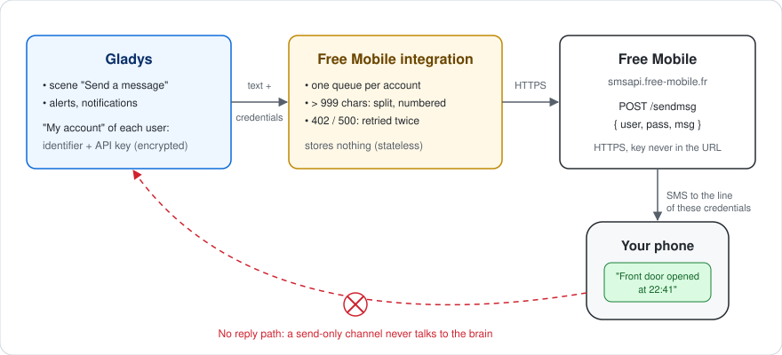
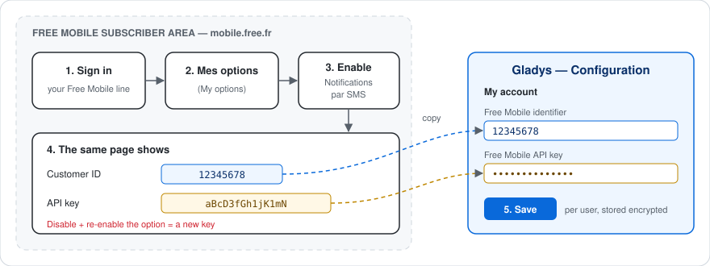
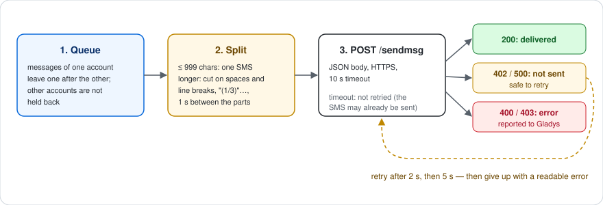

# gladys-free-mobile


External [Gladys Assistant](https://gladysassistant.com) integration that sends your Gladys notifications **by SMS to your own phone**, through the free **Free Mobile SMS API**. It is the external-integration port of the historical in-core `free-mobile` service: installed from the store in one click, running in its own container, updated independently of Gladys.

📖 User documentation: [English](docs/en.md) — [Français](docs/fr.md) — [Deutsch](docs/de.md) — [Español](docs/es.md)

## How it works



Free Mobile offers an outbound-only webhook: it sends an SMS **to the phone number of the account the credentials belong to** — never to an arbitrary number, and nothing comes back. The integration is therefore a **send-only communication integration** (`type: "communication"`, `messaging: { receive: false }`):

| Gladys side                                    | What the integration does                                         |
| ---------------------------------------------- | ----------------------------------------------------------------- |
| Scene action "Send a message", alerts, notices | One SMS to the user's phone (`onSendMessage`)                     |
| Message longer than 999 characters             | Several SMS, cut on spaces / line breaks and numbered `(1/2)`…    |
| Several messages for the same user at once     | Sent one after the other, so they do not trip the rate limit      |
| Free Mobile answers 402 (too fast) or 500      | Retried after 2 s, then 5 s, then reported as a readable error    |
| Attached image (`message.file`)                | Ignored: Free Mobile SMS carries text only                        |
| Reply to the SMS                               | Impossible: no inbound path, no linking code, no `publishMessage` |

Credentials are **per user**, not global: each user enters their own identifier and API key, and Gladys hands them to the integration with every outgoing message. The integration itself stores nothing.

## Setup



1. A **Free Mobile** line with the **"Notifications par SMS"** option enabled (`mobile.free.fr` → "Mes options").
2. In Gladys, each user fills **their own** identifier and API key in the **"My account"** block of the integration's Configuration screen (the manifest `contact_schema`, introduced by a short help section with a link to the subscriber area).
3. Save. There is no linking code to generate: Free Mobile has no channel to send one through, and a send-only channel carries no user authority to protect. Users without credentials are simply skipped by Gladys.

The step-by-step guide, with troubleshooting, is in the [user documentation](docs/en.md).

## Sending a message



## Design notes

**The API key never travels in a URL.** Free Mobile accepts the parameters either in a GET query string or in a POST body. The integration posts them as JSON: a query string ends up in proxy and access logs, a body does not. Errors never echo the request, and the identifier is masked in the logs (`12****78`).

**Only "not sent" answers are retried.** A 402 or a 500 means Free Mobile did not send the SMS, so a retry cannot deliver it twice. A timeout is _not_ retried: the SMS may have left before the answer was lost, and a duplicate alert is worse than a reported failure.

**One queue per account, not one global queue.** The rate limit applies to a Free Mobile line, so two users never wait for each other; a failed message does not block the ones queued after it.

**Every user-facing text exists in the four Gladys languages** (en, fr, de, es). `test/manifest.test.js` fails if a manifest text lacks one of them.

## Architecture

```
index.js              SDK wiring: onSendMessage, per-account queue, lifecycle
src/
  free-mobile.js      the Free Mobile HTTP call: POST, split, retry, queue
  config.js           per-user credentials: normalization, validation, masking
test/                 node:test unit tests, no network (fake fetch and clock)
docs/                 user documentation (en / fr / de / es) and diagrams
```

## Development

```bash
npm install
npm test              # node:test unit tests (no network)
npm run lint          # ESLint 10, flat config
npm run format:check  # Prettier
```

Validate the manifest against the store admission rules:

```bash
npx github:GladysAssistant/integration-store .
```

## Releasing

Releases are cut from GitHub: **Actions → Release → Run workflow**, then pick the bump. The workflow updates the version in `package.json` and the manifest, regenerates `CHANGELOG.md` from the Conventional Commits, pushes the commit and the tag in **one atomic push**, publishes the GitHub release and builds the multi-arch image (`linux/amd64` + `linux/arm64`), with the manifest embedded as an image label. The Gladys store indexer picks the new version up from the default branch.

## License

[Apache-2.0](LICENSE)
