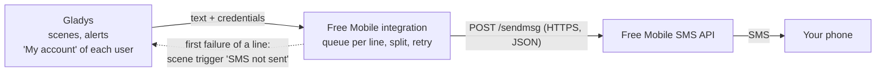
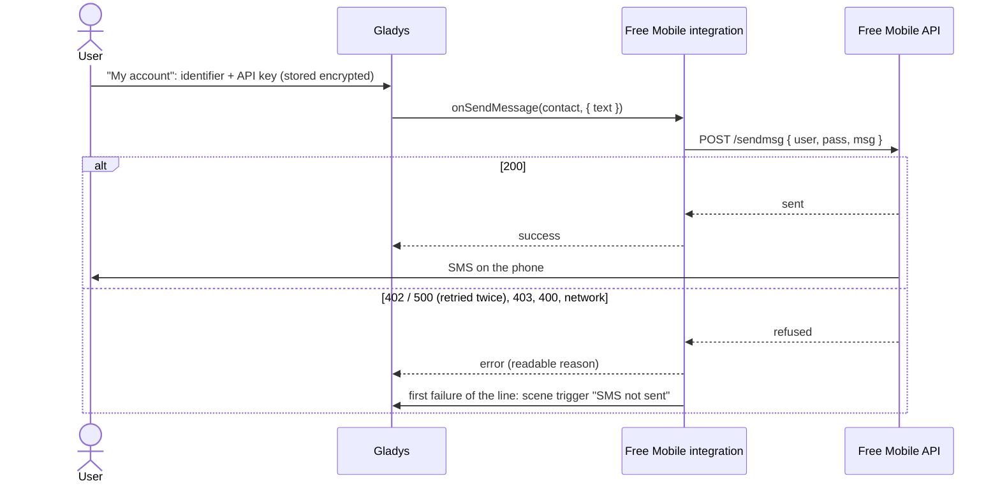
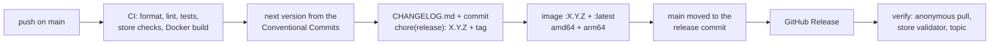

**English** · [Français](README.fr.md) · [Deutsch](README.de.md) · [Español](README.es.md)

# gladys-free-mobile

[](LICENSE)
[](https://github.com/William-De71/gladys-free-mobile/releases)
[](https://github.com/William-De71/gladys-free-mobile/actions/workflows/release.yml)
[](https://gladysassistant.com)


External [Gladys Assistant](https://gladysassistant.com) integration that sends your Gladys notifications **by SMS to your own phone**, through the free **Free Mobile SMS API**. It is the external-integration port of the historical in-core `free-mobile` service: installed from the store in one click, running in its own container, updated independently of Gladys.

📖 User documentation: [English](docs/en.md) — [Français](docs/fr.md) — [Deutsch](docs/de.md) — [Español](docs/es.md)

## Features

- **SMS notifications**: the "Send Message" scene action, alerts and notifications reach the phone of each user, through their own Free Mobile line.
- **Per-user credentials**: each user enters their own identifier and API key in the "My account" block; the integration stores nothing on disk.
- **Long messages**: more than 999 characters are sent as several numbered SMS, cut on spaces and line breaks.
- **Rate limit handled**: one queue per Free Mobile line, and the "not sent" answers (402, 500) are retried twice.
- **Scene trigger "SMS not sent"**: a scene starts on the first failure of a line (wrong API key, option disabled, Free Mobile down…), so you can be warned through another channel.
- **Four languages**: English, French, German and Spanish, in Gladys and in the documentation.

## How it works




Free Mobile offers an outbound-only webhook: it sends an SMS **to the phone number of the account the credentials belong to** — never to an arbitrary number, and nothing comes back. The integration is therefore a **send-only communication integration** (`type: "communication"`, `messaging: { receive: false }`):

| Gladys side                                  | What the integration does                                         |
| -------------------------------------------- | ----------------------------------------------------------------- |
| Scene action "Send Message", alerts, notices | One SMS to the user's phone (`onSendMessage`)                     |
| Message longer than 999 characters           | Several SMS, cut on spaces / line breaks and numbered `(1/2)`…    |
| Several messages for the same user at once   | Sent one after the other, so they do not trip the rate limit      |
| Free Mobile answers 402 (too fast) or 500    | Retried after 2 s, then 5 s, then reported as a readable error    |
| First failure of a Free Mobile line          | Scene trigger "SMS not sent" (`publishSceneEvent`)                |
| Attached image (`message.file`)              | Ignored: Free Mobile SMS carries text only                        |
| Reply to the SMS                             | Impossible: no inbound path, no linking code, no `publishMessage` |

Credentials are **per user**, not global: each user enters their own identifier and API key, and Gladys hands them to the integration with every outgoing message.

### From the scene to the SMS



## Configuration

Everything is set per user, in the **"My account"** block of the Configuration screen (manifest `contact_schema`):

| Field                  | Key            | Type     | Required | Content                                                   |
| ---------------------- | -------------- | -------- | -------- | --------------------------------------------------------- |
| Free Mobile identifier | `username`     | `string` | yes      | the 8-digit login of the "Notifications par SMS" page     |
| Free Mobile API key    | `access_token` | `secret` | yes      | the key of that page, stored encrypted, never shown again |


1. A **Free Mobile** line with the **"Notifications par SMS"** option enabled (`mobile.free.fr` → "Mes options").
2. In Gladys, each user fills **their own** identifier and API key in the **"My account"** block of the integration's Configuration screen.
3. Save. There is no linking code to generate: Free Mobile has no channel to send one through, and a send-only channel carries no user authority to protect. Users without credentials are simply skipped by Gladys.

To send a scene message **by SMS only**, pick **Free Mobile SMS** in the **"Send through"** list of the "Send Message" action (Gladys 4.86 or later); by default, a message goes to every messaging service of the user.

## Transport

The manifest declares `transports: ["cloud"]`: every SMS goes through the Free Mobile servers on the Internet. There is no device, so no transport badge to publish.

## Scenes

| Trigger        | Key            | When                                                                                            |
| -------------- | -------------- | ----------------------------------------------------------------------------------------------- |
| "SMS not sent" | `sms_not_sent` | the first failure of a Free Mobile line, then again only after an SMS of that line went through |

- Filter **Reasons** (optional, several values): `access_denied`, `rate_limited`, `server_error`, `timeout`, `unreachable`, `invalid_message`, `unexpected`.
- Variables: `{{triggerEvent.data.reason}}`, `{{triggerEvent.data.status}}` (HTTP status, empty without an answer), `{{triggerEvent.data.error}}` (English, as in the logs), `{{triggerEvent.data.account}}` (masked identifier, `12****78`).
- Example: trigger "SMS not sent", reason "Access denied" → action "Send Message" through **Telegram**: `Free Mobile refused an SMS ({{triggerEvent.data.error}}): check the API key.`

One event per transition keeps scenes from looping: a scene that warns you through this same channel fails again, and that second failure fires nothing.

## Sending a message


## Design notes

**The API key never travels in a URL.** Free Mobile accepts the parameters either in a GET query string or in a POST body. The integration posts them as JSON: a query string ends up in proxy and access logs, a body does not. Errors never echo the request, and the identifier is masked in the logs (`12****78`).

**Only "not sent" answers are retried.** A 402 or a 500 means Free Mobile did not send the SMS, so a retry cannot deliver it twice. A timeout is _not_ retried: the SMS may have left before the answer was lost, and a duplicate alert is worse than a reported failure.

**One queue per account, not one global queue.** The rate limit applies to a Free Mobile line, so two users never wait for each other; a failed message does not block the ones queued after it.

**Every user-facing text exists in the four Gladys languages** (en, fr, de, es). `test/i18n.test.js` fails if a manifest text, a doc or a README lacks one of them.

## Installation

From Gladys (5.1.0 or later): **Integrations → Store → Free Mobile SMS → Install**. The store lists the integration within the day of a release.

To test a build before its release: **Integrations → Install an integration → Developer mode**, with the manifest shown in the summary of the "Build and publish image" workflow.

## Development

```
index.js              SDK wiring only: createApp(new GladysIntegration()) + connect
src/
  app.js              every handler: onSendMessage, per-line queue, lifecycle
  free-mobile.js      the Free Mobile HTTP call: POST, split, retry, failure reasons
  events.js           scene trigger "SMS not sent", once per failing line
  config.js           per-user credentials: normalization, validation, masking
test/                 node:test, no network (fake Gladys of the SDK, fake fetch)
docs/                 user documentation (en / fr / de / es) and diagrams
.github/scripts/      release.mjs: version, changelog, version files, PR titles
```

```bash
npm install
npm test              # node:test, never touches the network
npm run lint          # ESLint 10, flat config
npm run format:check  # Prettier
npx github:GladysAssistant/integration-store . --skip-image-check
```

## Tests

- `test/app.test.js`: the handlers through the fake Gladys of the SDK (`@gladysassistant/integration-sdk/testing`): message sent, credentials missing, scene event once per failing line, data within the core limits, API key never in an event.
- `test/free-mobile.test.js`: the HTTP call, the split, the retries, the queue.
- `test/structure.test.js`: the keys users of 1.2.0 stored (`test/fixtures/manifest.baseline.json`) are unchanged.
- `test/i18n.test.js`, `test/manifest.test.js`: four languages, store limits, docs and READMEs.
- `test/release.test.js`: versions, changelog, version files and pull request titles.

## Release

Releases are **automatic**: every push on `main` publishes a version when its commits deserve one.



- **Commit convention** ([Conventional Commits](https://www.conventionalcommits.org/)): `feat` → minor, `fix` and `perf` → patch, `!` or `BREAKING CHANGE:` → major; `docs`, `chore`, `ci`, `test`, `style`, `refactor` and `build` alone publish nothing. The pull request title becomes the squash commit and the changelog line: write it in English, for the user.
- `main` only receives the bumped manifest once its image exists, so the store never announces a version Gladys cannot pull.
- Manual run (**Actions → Release → Run workflow**): `release-as` forces a version, `dry-run` shows the version and the changelog without publishing anything.
- `CHANGELOG.md` is generated: never edit it by hand.
- If `main` is protected, allow GitHub Actions to bypass the rule (the release commit is pushed by the workflow), or use a GitHub App token.

## Troubleshooting

- **No SMS received**: check that the "Notifications par SMS" option is enabled and that the identifier and API key are correct; the Supervision tab of the integration shows its logs, with the reason.
- **"access denied"**: wrong identifier or key, or option disabled. Disabling and re-enabling the option generates a new key.
- **"too many SMS sent"**: several messages within a few seconds; space out the "Send Message" actions of your scenes.
- **"timed out"**: Free Mobile did not answer in time; the SMS may still arrive, so it is not resent.
- **Update not offered**: the integration requires Gladys 5.1.0; update Gladys first.

## Contributing

Issues and pull requests are welcome: [bug report](https://github.com/William-De71/gladys-free-mobile/issues/new/choose) (with the Gladys and integration versions and the logs, ideally with `DEBUG=gladys-integration-sdk`), or the [forum thread](https://community.gladysassistant.com/t/10366). Security problems: see [SECURITY.md](SECURITY.md).

## License

[Apache-2.0](LICENSE) — see also [NOTICE](NOTICE). Free Mobile is a trademark of Free Mobile SAS; this project is not affiliated with Free Mobile.
